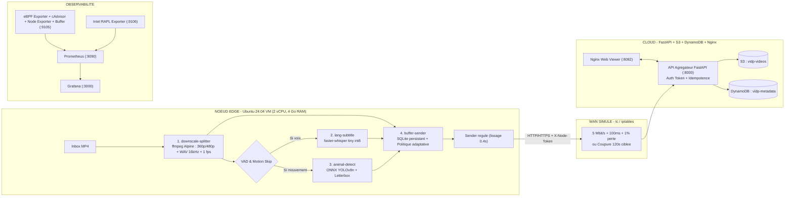

# Rapport Technique — Projet Cloud : VidP-Edge
### Pipeline Vidéo Hybride Adaptatif Edge–Cloud, Résilient et Frugal en Ressources

* **Sujet :** Projet 1 — *VidP-Edge*  
* **Dépôt Git :** `https://github.com/makeu05/projet-1`  
* **Date :** Novembre 2026  

---

## 1. Résumé exécutif

**VidP-Edge** est un système distribué de traitement vidéo Edge–Cloud conçu pour continuer à fournir un service utile lorsque le lien WAN est fortement dégradé (`5 Mbit/s`, délai `100 ms`, perte `1 %`) ou totalement coupé (`2 minutes`), tout en minimisant la bande passante réseau, la mémoire active (`WSS`), le CPU et l’énergie consommée.

Nos campagnes expérimentales sur 6 scénarios (données brutes archivées dans `monitoring/benchmark_summary.csv` et `monitoring/benchmark_raw_segments.csv`) démontrent que :
* Sous un WAN bridé à **`5 Mbit/s`**, la politique **Hybride adaptative** divise la latence **`p99` par 2** par rapport à la baseline *Cloud-only* (`16,9 s` vs `35,0 s`), tout en effectuant l’ensemble des traitements IA locaux (réduction `480p -> 360p`, détection de langue, sous-titres `.vtt`, détection d’animaux).
* Le filtrage local (détection d’activité vocale VAD + détection de mouvement + transfert sélectif) permet d’**éviter jusqu’à `81,0 %` du trafic WAN** (`1,65 Mo` transmis contre `8,71 Mo` bruts).
* Lors d’une **coupure WAN totale de `120 s`**, le nœud Edge absorbe l’intégralité des segments dans son buffer SQLite persistant (`max_backlog = 10`), garantit **`0 %` de perte**, déduplique les réessais et **résorbe la file d’attente en `10,3 s`** au retour du réseau.
* L’adaptation dynamique `480p -> 360p` réduit l’énergie nette par segment de **`26,4 %`** (`73,1 J/segment` contre `99,3 J/segment` en `480p` fixe) sans dégrader le `p99`.

---

## 2. Architecture du système

### 2.1 Vue d’ensemble Edge–Cloud

### 2.2 Choix d’ingénierie pour la frugalité des ressources
Pour respecter la contrainte d’empreinte minimale sans sacrifier les 4 traitements locaux :
1. **Décodage unique (`edge-downscale-splitter`) :** un seul conteneur `ffmpeg` (Alpine) transcode le flux (`480p` ou `360p`, `-preset veryfast -crf 30`) et produit simultanément l’audio `PCM 16 kHz mono` et `1 image/seconde` en JPEG. Les conteneurs IA ne ré-ouvrent jamais le flux H.264.
2. **Zéro PyTorch à l’exécution :**
   * `lang-subtitle` utilise **`faster-whisper` (`tiny`, quantification `int8`, `CTranslate2`)** avec **Silero VAD** (`vad_filter=True`) : les segments sans parole ne déclenchent aucune inférence.
   * `animal-detect` utilise **`ONNX Runtime`** (`yolov8n.onnx`, 13 Mo) avec pré-filtrage par différence de pixels (`MOTION_THRES = 2.0`) : les frames fixes sont ignorées (`skip`), et les vidéos verticales `9:16` conservent leur ratio via *letterbox padding*.
3. **Transfert sélectif & Politique Hybride adaptative :**
   * En modes `edge-first` et `adaptive-hybrid`, les segments sans voix ni animal n’envoient que le JSON de métadonnées (~300 octets) au lieu du clip vidéo.
   * En mode `adaptive-hybrid`, `buffer-sender` mesure le débit réel d’upload et le backlog SQLite : si `backlog >= 1`, `WAN = 0`, ou débit `< 6 Mbit/s`, il écrit `360` dans `/data/policy/target_height` afin que `downscale-splitter` bascule automatiquement de `480p` à `360p`.
4. **Reprise contrôlée & Déduplication :**
   * Le buffer SQLite conserve les segments `PENDING` sur disque lors des coupures WAN et les écoule avec un lissage (`PACE_DELAY_S = 0.4 s`) pour éviter de saturer un lien contraint au rétablissement.
   * Côté Cloud, `api-aggregator` garantit l’idempotence via écriture conditionnelle DynamoDB (`ConditionExpression="attribute_not_exists(segment_id)"`).

---

## 3. Modèle de menace et sécurité

| Actif critique | Menace identifiée | Contremesure implémentée / prévue |
| :--- | :--- | :--- |
| **Credentials AWS (S3 / DynamoDB)** | Compromission du nœud Edge physique (vol ou accès local) donnant accès au Cloud AWS | **Aucune clé AWS sur l’Edge.** Seul l’agrégateur Cloud communique avec S3/DynamoDB (IAM Role ou `.env` `0600` côté Cloud uniquement). |
| **API d’ingestion Cloud** | Injection de faux segments ou usurpation d’un nœud Edge | Authentification obligatoire par jeton **`X-Node-Token`** (extensible vers mTLS par nœud). |
| **Dépôt Git & Images Docker** | Fuite accidentelle de clés API, certificats ou états Terraform | `.gitignore` strict (`*.tfvars`, `.env`, `*.pem`, `*.tfstate*`, `dataset/`), contrôle `grep` pré-commit, secrets injectés uniquement au runtime par Ansible. |
| **Surface système des conteneurs** | Saturation CPU/RAM (DoS) par une vidéo corrompue ou volumineuse | Quotas stricts par conteneur (`cpus` et `mem_limit` dans `docker-compose.yml`), borne `client_max_body_size 100M` sur Nginx. |
| **Rejeu / Doublons réseau** | Ré-émission multiple d’un segment lors de pertes `1 %` ou reprise après coupure | Identifiant unique `segment_id` + écriture conditionnelle atomique DynamoDB (`attribute_not_exists`). |
| **Confidentialité du flux WAN** | Interception des flux vidéo bruts sur Internet | Filtrage local Edge (seuls les extraits pertinents sortent) ; chiffrement HTTPS/TLS en terminaison Nginx pour le déploiement AWS public. |

---

## 4. Protocole expérimental et métrologie

### 4.1 Banc de test
* **Poste hôte / Cloud & Observabilité :** PC Kali Linux dual-boot (`32 Go RAM`, noyau `6.16.8`, compteurs matériels **`Intel RAPL`** exposés via `/sys/devices/virtual/powercap`), exécutant `Floci` (S3 + DynamoDB locaux), `FastAPI`, `Nginx`, `Prometheus`, `Grafana`, `cAdvisor 0.60.6` et `rapl-exporter`.
* **Nœud Edge :** VM KVM Ubuntu 24.04.1 LTS (`2 vCPU`, `4 Go RAM`, noyau `7.0.0-43`), horloge synchronisée par **`chrony`**, déployée de bout en bout par **Ansible** (`deploy/edge.yml`).
* **Perturbations WAN (`tc` & `iptables`) :**
  * Bridage `5 Mbit/s` + délai `100 ms ± 15 ms` + perte `1 %` appliqué via `tc` (`htb` + `netem` + filtre `u32`) **uniquement** sur le trafic sortant vers `<CLOUD_IP>:8000`.
  * Coupure totale `120 s` appliquée via `iptables` sur les chaînes `DOCKER-USER` et `OUTPUT` vers `<CLOUD_IP>:8000` (préservant SSH et le scraping Prometheus/Grafana en direct).
* **Jeu de test reproductible (4 vidéos $\rightarrow$ 10 segments au total) :**
  1. `animals_speech/sample_dog_fr.mp4` (chien + voix FR),
  2. `animals_only/9HKrrfgTN5k.mp4` (animaux sans voix),
  3. `speech_only/2UqIJlVQE7o.mp4` (voix sans animal),
  4. `calm_empty/calm_forest_sim.mp4` (`20 s` scène calme sans voix ni animal).

### 4.2 Validation fonctionnelle des modèles (sur dataset multi-catégories)
Exécuté avec `CONF_THRES = 0.50` et Silero VAD actif (`scripts/eval_dataset.py`) :

| Catégorie | Segments | Animaux détectés | Parole / Langues | Vidéos envoyées | Latence `p50` | Latence `p99` |
| :--- | :---: | :--- | :--- | :---: | :---: | :---: |
| `animals_only` | 4 | `3/4` (`bear`, `dog`, `horse`) | `0/4` (`[]` — 0 hallucination) | `3/4` | `8 038 ms` | `10 798 ms` |
| `animals_speech` | 4 | `1/4` (`dog`, 0 faux positif) | `4/4` (`fr`) | `4/4` | `26 397 ms` | `28 479 ms` |
| `speech_only` | 6 | `0/6` (`[]` — 0 faux positif) | `4/6` (`en`, `fr`) | `4/6` | `20 515 ms` | `23 569 ms` |

---

## 5. Résultats, Percentiles et Intervalles

### 5.1 Tableau synthétique des 6 scénarios (`monitoring/benchmark_summary.csv`)
*(Puissance idle mesurée avant campagne : **`12,34 W`** sur `intel-rapl:0_package-0`).*

| Scénario | Mode & Résolution | `p50` (ms) | `p95` (ms) | `p99` (ms) | WAN envoyé (Mo) | Volume évité | Backlog max | Reprise | Peak WSS (MiB) | CPU moy (cœurs) | Énergie nette (`J` / `J/seg`) |
| :--- | :--- | :---: | :---: | :---: | :---: | :---: | :---: | :---: | :---: | :---: | :---: |
| `01_cloud_only` | `cloud-only` (`raw`) | 4 045 | 7 771 | 7 771 | 8,71 | 0,0 % | 6 | 0,0 s | 667,2 | 0,224 | 48,5 J (`4,9 J/seg`) |
| `02_cloud_only_5mbit` | `cloud-only` (`raw`, 5M) | 27 607 | 34 987 | **34 987** | 8,71 | 0,0 % | 6 | 0,0 s | 679,8 | 0,175 | 311,6 J (`31,2 J/seg`) |
| `03_edge_first` | `edge-first` (`360p`) | 17 262 | 31 847 | 31 847 | **1,65** | **81,0 %** | 2 | 0,0 s | 827,3 | 1,381 | 1 351,6 J (`135,2 J/seg`) |
| `04_adaptive_hybrid` | `adaptive` (`480p`) | 9 994 | 27 624 | 27 624 | 2,19 | 74,9 % | 2 | 0,0 s | 840,7 | 1,295 | 992,5 J (`99,3 J/seg`) |
| `05_adaptive_5mbit` | `adaptive` (`360p+480p`, 5M) | **9 754** | **16 900** | **16 900** | 2,17 | **75,1 %** | 2 | 0,0 s | 836,9 | 1,544 | **731,5 J (`73,1 J/seg`)** |
| `06_wan_cut_2min` | `adaptive` (`360p`, cut 120s) | 98 033 | 111 898 | 111 898 | **1,65** | **81,0 %** | **10** | **10,3 s** | 808,0 | 0,774 | 1 268,8 J (`126,9 J/seg`) |

### 5.2 Analyse des percentiles, intervalles et compromis (trade-offs)
1. **Latence & Intervalles `[p50 ; p99]` :**
   * En lien WAN non contraint (`01`), `cloud-only` est rapide au transfert (`[4,0 s ; 7,8 s]`) mais n’effectue **aucune analyse IA** (le coût de transcription/détection est simplement reporté sur le Cloud).
   * Dès que le WAN est réaliste (`5 Mbit/s` + `100 ms` + `1 %` perte), l’intervalle `cloud-only` bondit à **`[27,6 s ; 35,0 s]`**, alors que `05_adaptive_5mbit` reste contenu dans **`[9,8 s ; 16,9 s]`** (soit **2,07× plus rapide au `p99`**) grâce au transfert sélectif et au passage dynamique en `360p`.
   * *Note statistique sur les intervalles :* chaque scénario portant sur $N = 10$ segments, l’indice du `95e` et du `99e` percentile coïncide avec le maximum observé (`p95 = p99`). Les 60 mesures individuelles sont disponibles dans `monitoring/benchmark_raw_segments.csv`.
2. **Efficacité réseau & Énergie :**
   * L’Edge consomme davantage de CPU local (`~1,3–1,5` cœurs en pic transcodage/inférence, `WSS` pic ~`840 MiB` dont ~`150 MiB` pour la stack d’observabilité), mais réduit de **`75 %` à `81 %`** les octets émis sur le WAN.
   * La comparaison `04_adaptive_hybrid` (`480p`, `99,3 J/seg`) vs `05_adaptive_5mbit` (`360p+480p`, `73,1 J/seg`) valide le **Bonus Énergie** : l’adaptation en `360p` réduit de **`26,4 %`** l’énergie nette par segment tout en maintenant un `p99` plus bas (`16,9 s` vs `27,6 s`) et la même qualité de détection.
3. **Résilience en mode déconnecté (`06_wan_cut_2min`) :**
   * Pendant les `120 s` de coupure, `100 %` des 10 segments ont été traités et mis en file SQLite (`max_backlog = 10`), puis ré-émis avec `0 %` de perte en **`10,3 s`** après rétablissement du lien (`p50 = 98,0 s`, `p99 = 111,9 s` correspondant au temps d’attente dans la coupure).

---

## 6. Limites et risques résiduels

1. **Périmètre de mesure énergétique (RAPL hôte vs nœud nu) :** L’hyperviseur KVM n’exposant pas `/sys/class/powercap/intel-rapl` à l’intérieur de la VM Edge, la mesure physique RAPL porte sur le package CPU de l’hôte complet (Edge VM + Cloud local) après soustraction de la puissance idle (`12,34 W`). Une mesure directe sur matériel Edge nu (type Raspberry Pi / mini-PC) éliminerait la variance des processus hôtes.
2. **Taille de l’échantillon ($N = 10$ segments/scénario) :** Sur 10 segments, les queues de distribution `p95` et `p99` sont confondues avec le maximum et sensibles à la variabilité d’un seul segment. Une campagne prolongée ($N \ge 100$) permettrait de calculer des intervalles de confiance *bootstrap* plus serrés.
3. **Émulation Cloud locale (`Floci`) vs AWS réel :** Les essais ont été exécutés avec `Floci` (S3 + DynamoDB locaux) suite à la mise en attente KYC du compte AWS personnel ; le code Terraform (`infra/`) et Ansible (`deploy/cloud.yml`) est prêt pour basculer sur EC2/S3/DynamoDB réels dès fourniture des credentials AWS définitifs.
4. **Point de défaillance unique (SPOF) Cloud & Sécurité WAN :** L’architecture actuelle déploie un seul conteneur d’agrégation API sur HTTP local ; en production, un reverse proxy TLS (HTTPS) et une réplication multi-instances derrière Load Balancer restent nécessaires.
5. **Précision des modèles frugaux :** L’utilisation de `whisper tiny int8` et `YOLOv8n` privilégie la frugalité (`WSS` < `850 MiB`) au détriment des clips très courts ou fortement bruités (nécessitant un calibrage `CONF_THRES = 0.50` pour éviter les faux positifs).
