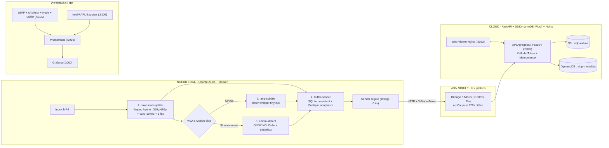

# VidP-Edge — Pipeline Vidéo Hybride Adaptatif (Edge–Cloud)

> **Projet Cloud — Sujet 1 (VidP-Edge)**  
> Pipeline conteneurisé de traitement vidéo adaptatif sur nœud Edge à faible consommation de ressources, résilient aux coupures et bridages WAN (`tc`), avec observabilité complète (`eBPF`, `Prometheus`, `Grafana`, `Intel RAPL`).  
> Voir l’analyse détaillée dans [`RAPPORT_TECHNIQUE.md`](./RAPPORT_TECHNIQUE.md).

---

## 1. Architecture & Traitements locaux



### Microservices déployés
| Composant | Rôle | Choix d’optimisation |
| :--- | :--- | :--- |
| `edge/downscale-splitter` | Découpe en segments de 10 s (`360p`/`480p`), extrait WAV 16 kHz et frames `1 fps` | 1 seul décodage `ffmpeg` (`-preset veryfast -crf 30`) |
| `edge/lang-subtitle` | Détection de la langue + génération des sous-titres `.vtt` | `faster-whisper` `tiny` (`int8`) + **Silero VAD** |
| `edge/animal-detect` | Détection d’animaux (classes COCO 14–23) | `ONNX Runtime` (`yolov8n.onnx`, 13 Mo) + *motion skip* + *letterbox* |
| `edge/buffer-sender` | File SQLite persistante, reprise lissée, politique `480p <-> 360p` | Transfert sélectif (métadonnées seules si scène calme) |
| `cloud/api-aggregator` | API FastAPI, auth `X-Node-Token`, déduplication DynamoDB, upload S3, `/metrics` | Écriture conditionnelle `attribute_not_exists(segment_id)` |
| `cloud/web-viewer` | Interface Web publique (`Nginx` + HTML/JS) | Lecteur vidéo avec sous-titres `.vtt`, filtres & export `.mp4`/`.vtt` |
| `monitoring/` | `Prometheus`, `Grafana`, `cAdvisor 0.60.6`, `node-exporter`, `ebpf_exporter`, `rapl-exporter` | Mesure `p50/p95/p99`, `WSS`, CPU, `Pkt/s` et Watts RAPL réels |

---

## 2. Structure du dépôt

```text
.
├── README.md                  # Guide de redéploiement et d'exploitation
├── RAPPORT_TECHNIQUE.md       # Rapport complet (architecture, menace, résultats, limites)
├── docker-compose.local.yml   # Stack Cloud + Floci (S3/DynamoDB) + Prometheus + Grafana + RAPL
├── deploy/
│   ├── inventory.ini          # IP et utilisateur SSH du nœud Edge
│   └── edge.yml               # Playbook Ansible (Docker, chrony, tc, Edge + eBPF + cAdvisor)
├── edge/                      # Microservices Edge (splitter, whisper, yolov8-onnx, buffer)
├── cloud/                     # API FastAPI + Interface Web Nginx
├── monitoring/
│   ├── prometheus.yml         # Cibles Cloud, Edge et RAPL
│   ├── grafana-datasource.yml # Provisionnement auto Prometheus -> Grafana
│   ├── rapl-exporter/         # Sonde d'énergie physique Intel RAPL
│   ├── benchmark_summary.csv  # Résultats synthétiques des 6 scénarios
│   └── benchmark_raw_segments.csv # Données brutes des 60 segments
├── scripts/
│   ├── tc_limit.sh            # Bridage tc (5/10 Mbit/s + 100ms + 1%) ciblé sur IP Cloud
│   ├── tc_cut_2min.sh         # Coupure WAN 120s (DOCKER-USER + OUTPUT, préserve SSH/Grafana)
│   ├── build_dataset.sh       # Constitution du jeu de vidéos de test via yt-dlp
│   ├── eval_dataset.py        # Évaluation précision par catégorie (animaux, langues, économie)
│   └── run_benchmark.py       # Exécution automatisée des 6 scénarios + export CSV
└── demo/sample.mp4            # Vidéo de démonstration (chien + parole française)
```

---

## 3. Procédure de redéploiement rapide (Démo Live)

### Prérequis sur le poste de contrôle
* `docker` + `docker compose`, `ansible >= 2.15`, `awscli`, `python3`
* Accès SSH sans mot de passe vers le nœud Edge cible (`ssh-copy-id <user>@<IP_EDGE>`)

### Étape 1 — Démarrer le bloc Cloud & Observabilité (1 min)
```bash
git clone https://github.com/makeu05/projet-1.git
cd projet-1

docker compose -f docker-compose.local.yml up -d --build

# Initialiser le bucket S3 et la table DynamoDB (émulateur local Floci)
export AWS_ENDPOINT_URL="http://localhost:4566"
export AWS_DEFAULT_REGION="eu-west-3"
export AWS_ACCESS_KEY_ID="test"
export AWS_SECRET_ACCESS_KEY="test"
aws s3 mb s3://vidp-videos || true
aws dynamodb create-table \
  --table-name vidp-metadata \
  --attribute-definitions AttributeName=segment_id,AttributeType=S \
  --key-schema AttributeName=segment_id,KeyType=HASH \
  --billing-mode PAY_PER_REQUEST || true
```

### Étape 2 — Déployer le nœud Edge sur les adresses IP fournies (2 min)
1. Renseigner l’IP du nœud Edge dans `deploy/inventory.ini` et dans `monitoring/prometheus.yml`.
2. Mettre l’IP du Cloud dans `CLOUD_API_URL` de `deploy/edge.yml` (par défaut `http://192.168.122.1:8000/api/segments`).
3. Lancer Ansible :
```bash
ansible-playbook -i deploy/inventory.ini deploy/edge.yml -K
docker compose -f docker-compose.local.yml restart prometheus
```

### Étape 3 — Interfaces de contrôle
* **Web Viewer public :** `http://localhost:8082`
* **Grafana (`admin` / `admin`) :** `http://localhost:3000`
* **Prometheus Targets :** `http://localhost:9090/targets`

---

## 4. Scénario de démonstration live (Nominal $\rightarrow$ Panne $\rightarrow$ Récupération)

1. **Régime nominal :** envoyer la vidéo de démonstration sur l’Edge :
   ```bash
   scp demo/sample.mp4 <user>@<IP_EDGE>:/tmp/sample.mp4
   ssh <user>@<IP_EDGE> "mv /tmp/sample.mp4 /opt/vidp-edge/data/inbox/"
   ```
   $\rightarrow$ Observer sur `http://localhost:8082` la vidéo `480p`, la langue (`fr`), les sous-titres `.vtt` et les détections (`dog`).

2. **Perturbation 1 — Bridage WAN à `5 Mbit/s` :**
   ```bash
   ssh -t <user>@<IP_EDGE> "sudo /opt/vidp-edge/tc_limit.sh 5 <IP_CLOUD> 8000"
   ```
   $\rightarrow$ Observer la bascule adaptative **`480p` $\rightarrow$ `360p`** tout en maintenant un `p99` bas. Remettre à zéro avec `tc_limit.sh reset`.

3. **Perturbation 2 — Coupure WAN totale de `120 s` (SSH & Grafana restent en ligne) :**
   ```bash
   ssh -t <user>@<IP_EDGE> "sudo /opt/vidp-edge/tc_cut_2min.sh <IP_CLOUD> 8000 120"
   ```
   $\rightarrow$ Injecter une vidéo pendant la coupure : `WAN UP` tombe à `0` et `vidp_edge_buffer_backlog` monte dans Grafana.  
   $\rightarrow$ À `t = 120 s`, le lien revient (`WAN UP = 1`), le buffer se vide en ~`10 s` et tous les segments apparaissent sur `:8082` avec **`0 %` de perte**.

4. **Lancer le benchmark automatisé complet (6 scénarios) :**
   ```bash
   python3 scripts/run_benchmark.py
   ```

---

## 5. Synthèse des résultats mesurés (`monitoring/benchmark_summary.csv`)

| Scénario | Mode & Résolution | `p50` | `p99` | Volume WAN évité | Pertes | Reprise | Énergie nette / seg |
| :--- | :--- | :---: | :---: | :---: | :---: | :---: | :---: |
| `01_cloud_only` | `cloud-only` (`raw`) | 4,0 s | 7,8 s | 0,0 % | 0 % | — | 4,9 J |
| `02_cloud_only_5mbit` | `cloud-only` (`raw`, 5 Mbit/s) | 27,6 s | **35,0 s** | 0,0 % | 0 % | — | 31,2 J |
| `03_edge_first` | `edge-first` (`360p`) | 17,3 s | 31,8 s | **81,0 %** | 0 % | — | 135,2 J |
| `04_adaptive_hybrid` | `adaptive` (`480p`) | 10,0 s | 27,6 s | 74,9 % | 0 % | — | 99,3 J |
| `05_adaptive_5mbit` | `adaptive` (`360p+480p`, 5 Mbit/s) | **9,8 s** | **16,9 s** | **75,1 %** | 0 % | — | **73,1 J (-26,4 %)** |
| `06_wan_cut_2min` | `adaptive` (`360p`, coupure 120 s) | 98,0 s | 111,9 s | **81,0 %** | **0 %** | **10,3 s** | 126,9 J |
